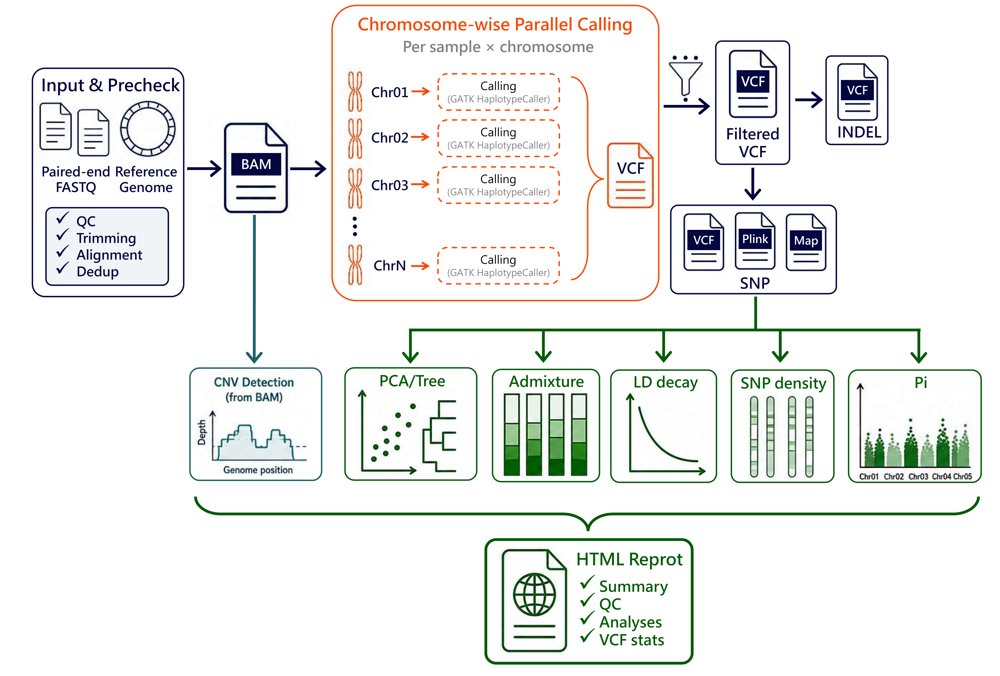

# ParaChrSNP

Current release: **v0.1.1**. Existing cohort VCFs can enter population-genomic
analyses directly through `Snakefile.downstream`.

[](https://parachrsnp.readthedocs.io/en/latest/)
[](https://snakemake.github.io/)
[](https://apptainer.org/)

ParaChrSNP is a containerized Snakemake workflow for chromosome-wise SNP and
INDEL discovery from paired-end resequencing data. It connects read quality
control, alignment, duplicate removal, GATK variant calling, cohort joint
calling, hard filtering, format conversion, annotation, and optional
population-genomic analyses in a reproducible workflow.

> Installation, container download, complete configuration, quick-start
> examples, command usage, Web interface instructions, output interpretation,
> changelog, and troubleshooting are maintained in the
> **[ParaChrSNP Read the Docs documentation](https://parachrsnp.readthedocs.io/en/latest/)**.
> A **[Chinese documentation site (中文文档)](https://parachrsnp.readthedocs.io/zh-cn/latest/)**
> is also available.

## Workflow overview

<p align="center">
  
</p>

ParaChrSNP divides variant discovery into independent sample-by-chromosome
jobs. These jobs can run concurrently and are subsequently integrated into a
cohort VCF. This design reduces the wall-clock time of large resequencing
projects while retaining per-chromosome intermediate results for inspection
and rerunning.

The workflow supports three alignment backends (`minibwa`, `bwa-mem2`, and
legacy `bwa`) and three joint-calling modes (GATK GenomicsDB,
`CombineGVCFs`, and GLnexus). Mapping output passes through samblaster and
SAMtools to produce sorted, duplicate-removed BAM files without storing a
large intermediate SAM file.

## Main features

- Per-sample, per-chromosome parallel GATK HaplotypeCaller execution.
- GenomicsDB, GLnexus, and legacy CombineGVCFs joint-calling modes.
- Containerized execution with Singularity or Apptainer.
- Configurable GATK hard filtering for SNPs and INDELs.
- Missingness assessment and PLINK/HapMap format conversion.
- Optional Beagle imputation and SnpEff functional annotation.
- Optional CNVnator read-depth CNV detection.
- Optional Pi, SNP-density, PCA, VCF2Dis, ADMIXTURE, and PopLDdecay analyses.
- Integrated precheck, summary tables, publication-oriented figures, and HTML
  reporting.
- Server-side Web interface for configuration, submission, monitoring, and
  report access.

## Performance

The following wall-clock times were recorded using 64 CPU cores and 512 GB
RAM. Runtime is reported in minutes.

| Species | Genome size | 10× | 30× | 50× | 100× |
| --- | ---: | ---: | ---: | ---: | ---: |
| Arabidopsis | 0.12 Gb | 2.72 | 8.56 | 13.98 | 25.75 |
| Watermelon | 0.37 Gb | 8.16 | 22.75 | 39.71 | 82.64 |
| Soybean | 0.98 Gb | 24.82 | 74.26 | 128.81 | 251.53 |
| Tea | 2.96 Gb | 71.64 | 201.31 | 394.05 | 746.34 |

Actual runtime depends on sample number, read length, storage performance,
selected joint-calling method, enabled optional modules, and available CPU and
memory resources.

## Documentation

- [English documentation](https://parachrsnp.readthedocs.io/en/latest/)
- [中文文档](https://parachrsnp.readthedocs.io/zh-cn/latest/)
- [Installation and software download](https://parachrsnp.readthedocs.io/en/latest/installation/index.html)
- [Quick start](https://parachrsnp.readthedocs.io/en/latest/quick_start/index.html)
- [Usage and complete configuration](https://parachrsnp.readthedocs.io/en/latest/usage/index.html)
- [Optional analysis modules](https://parachrsnp.readthedocs.io/en/latest/usage/optional_modules.html)
- [Web interface](https://parachrsnp.readthedocs.io/en/latest/web_interface/index.html)
- [FAQ and troubleshooting](https://parachrsnp.readthedocs.io/en/latest/faq/index.html)
- [Changelog](https://parachrsnp.readthedocs.io/en/latest/changelog/index.html)

The source repository is hosted at
[github.com/majssssa/ParaChrSNP](https://github.com/majssssa/ParaChrSNP).
Please follow the installation documentation for the current source,
container, dependencies, and example dataset instead of relying on copied or
outdated commands.

## Start From an Existing VCF

Follow the step-by-step [English tutorial](https://parachrsnp.readthedocs.io/en/latest/usage/downstream.html)
or [中文教程](https://parachrsnp.readthedocs.io/zh-cn/latest/usage/downstream.html)
for a separate working directory and the tested container bindings.

The independent entry point `Snakefile.downstream` runs only downstream analyses from an existing VCF. Copy and edit `config.downstream.example.yaml`: set `input_vcf` to a genotyped cohort `.vcf` or `.vcf.gz`, `reference` to the matching FASTA, and `container.image` to your installed image. Sample IDs are read automatically from the VCF header. Use a separate working directory from previous analyses to avoid reusing unrelated outputs.

Validate the VCF-only task graph, then run the downstream workflow.

```bash
snakemake --snakefile Snakefile.downstream --configfile config.downstream.example.yaml --cores 1 -n
snakemake --snakefile Snakefile.downstream --configfile config.downstream.example.yaml --cores 8 --use-singularity
# --snakefile Snakefile.downstream: selects the versioned workflow with VCF support.
# --configfile config.downstream.example.yaml: supplies the VCF, reference and downstream settings.
# --cores: limits the total available CPU threads.
# -n: checks the task graph without executing jobs.
# --use-singularity: runs tools with the configured container.
```

VCF mode skips read QC, alignment, BAM processing and variant calling. It sorts and BGZF-compresses a copy of the input without changing the original. Downstream SNP analyses use biallelic SNP records with FILTER `PASS` or `.`; INDEL records with these FILTER values are also exported. No additional GATK hard filters are applied. The input must contain GT genotypes, not gVCF reference blocks. PCA/tree analysis require at least three samples. Enable ADMIXTURE, LD decay, nucleotide diversity, SNP density, Beagle imputation or SnpEff annotation through their existing `params.*.enabled` settings; annotation requires matching annotation resources. BAM-based CNV detection is not part of this standalone workflow. Read-based QC/depth metrics are reported as unavailable. Reports are written to `reports/ParaChrSNP_report.html` and `reports/ParaChrSNP_summary.tsv`.

## Contact

**Author:** Junpeng Ma<br>
**Email:** 1527552938@qq.com<br>
**WeChat:** mjp59876
